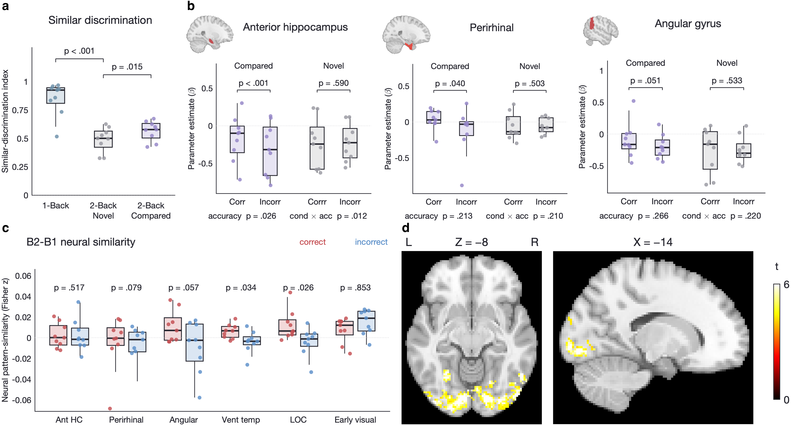

# Neural mechanisms of interaction between episodic memory and working memory

**Request for additional funding for an ongoing pilot study**

Applicants: Zihan Bai (NYU PhD in C&P, global program) and Sebastian Michelmann (NYU).

**Introduction:** Working memory (WM) maintains information after it leaves the sensory environment, but its capacity is limited (Luck & Vogel, 1997). Episodic memory (EM) rapidly encodes distinct, high-resolution representations of individual events (Tulving, 1983). Our pilot study set out to localize the site of EM-WM integration and to assess the neural mechanisms that endow EM with its ability to support WM. With the initial award, we scanned nine participants in the MST-back task while recording eye movements. **These data confirm our primary hypothesis and identify the reinstatement of episodic content in cortex as a mechanism by which EM supports WM. We request additional scanner time to double the sample (N = 18) and to add the high-resolution hippocampal imaging that resolves this mechanism at the level of hippocampal subfields.**

**Progress report:**

**Data collection.** All tokens of the initial award have been used. Nine participants completed the MST-back protocol with concurrent eye tracking: four pairs of one-back (encoding) and two-back (retrieval) runs, followed by a final mnemonic similarity run. All datasets are preprocessed and analyzed, with single-trial responses estimated for every image presentation (920 MST-back trials per participant).

**Behavior.** Our previous behavioral finding replicates in the scanner (Figure 1a): In the two-back phase, similar pair-mates that had previously been compared to each other were discriminated better than novel pair-mates (p = .015), while the identification of identical items was not significantly modulated.

**Primary hypothesis (univariate):** **The anterior hippocampus was more active for successful than for unsuccessful discrimination of compared pair-mates (p < .001), and this success signal was selective for the condition in which EM is available (condition × accuracy interaction: p = .012; Figure 1b).** This is the signature that we predicted for a shared subnetwork that modulates the successful discrimination of similar pair-mates when EM is available. We tested the prediction in an a priori network of EM regions by contrasting the difference in BOLD response for successful vs. unsuccessful discrimination in the compared condition (EM available), as well as in the novel condition (no EM available). Perirhinal cortex also showed a success signal for compared pair-mates (p = .040), with a promising effect in the angular gyrus (p = .051). In the same regions, the detection of identical repeats showed no evidence of a success signal (all p > .6), consistent with an episodic contribution that is selective for the discrimination of similar items rather than for the recognition of previously encountered items. This neural dissociation parallels the behavioral benefit of prior comparison, which was likewise selective for similar-item discrimination. Object-selective visual regions (ventral temporal and lateral occipital cortex) distinguished correct from incorrect discrimination in both the compared and the novel condition (all p < .05), whereas low-level visual regions (V1/V2) did not (all p > .1). The condition-general success signal in higher-order visual cortex indicates that the compared-selective signal in the episodic-memory network does not reflect a generic correlate of correct responding, and its absence in early visual cortex argues against an account based on low-level perceptual differences. In an independent contrast from the final mnemonic similarity task, memory success was predicted by the posterior hippocampus (p = .022), the angular gyrus (p = .007), and the precuneus (p = .011), independently localizing the episodic-memory network.

**Primary hypothesis (multivariate):** As proposed, we first localized regions in which neural similarity tracks image similarity. In a whole-brain searchlight, the similarity of voxel patterns followed the similarity of the images in early and ventral visual cortex and in lateral occipital cortex (TFCE, FWE-corrected p < .05; Figure 1d), confirming that these patterns carry item-specific content. We then tested how EM supports WM by comparing the voxel pattern during target presentation in the two-back phase with the voxel pattern of the same target in the one-back phase (B2-B1 similarity; pattern completion). **Pattern completion was higher for successful than for unsuccessful discrimination in ventral temporal cortex (p = .034) and lateral occipital cortex (p = .026; Figure 1c)**, with promising effects in the same direction in perirhinal cortex (p = .079) and the angular gyrus (p = .057). **The pilot data thus identify pattern completion, a hippocampal success signal together with the cortical reinstatement of the episodic memory, as a neural mechanism by which EM supports WM.** The two remaining predictions of our proposal, pattern separation in the dentate gyrus (A1-B1 similarity) and predictive recall (A2-B1 similarity), are the targets of the extension: They were the smaller effects in our behavioral study, and pattern separation requires the resolution of hippocampal subfields.

**Figure 1. Pilot results.** (a) Discrimination of similar items in the one-back phase and in the two-back phase for novel and compared pair-mates. (b) BOLD response for correct vs. incorrect discrimination of compared and novel pair-mates in the anterior hippocampus, perirhinal cortex, and angular gyrus. (c) B2-B1 pattern similarity (pattern completion) for correct vs. incorrect discrimination across the a priori network. (d) Whole-brain searchlight: neural pattern similarity tracks image similarity (group t, TFCE sign-flip FWE-corrected p < .05).

**Update on design:**

**The MST-back task in the scanner:** We streamlined the task for fMRI. Each run contrasts previously compared pair-mates with novel pair-mates; we dropped the isolated condition to maximize the number of trials in the two conditions that define our primary hypothesis. Each one-back run comprises 130 trials and each two-back run 100 trials, with a slower event timing than in the behavioral study (1.5 s image presentation, mean SOA ≈ 3 s) that supports the estimation of single-trial responses. Across the four two-back runs, every participant contributes 40 similar-item discriminations in the compared condition and 40 in the novel condition. The final mnemonic similarity run comprises 120 trials.

**Analysis.** Because every image is presented only once per task phase, single-trial responses are estimated with a least-squares-separate model. Pattern similarity is expressed as the rank correlation between single-trial voxel patterns relative to a baseline of non-matching items, which directly mirrors the analysis of gaze-pattern reinstatement in our previous study. All hypotheses are tested in an a priori network of EM regions (hippocampus, perirhinal cortex, angular gyrus, ventral temporal and lateral occipital cortex), with early visual cortex and prefrontal regions as controls.

**Planned extension.** (1) We will scan nine additional participants with the identical functional protocol, for a combined sample of N = 18. The pattern completion effects in the pilot sample correspond to effect sizes of d ≈ 0.5-0.75; doubling the sample raises the power to detect an effect of d = 0.6 from 50% to 79%.

(2) Every additional session will include the high-resolution oblique-coronal T2 (0.4 × 0.4 × 2 mm, spanning the hippocampal long axis) for automated subfield segmentation (ASHS-T2; DG/CA3, CA1, subiculum). Hippocampal analyses to date divide the hippocampus along its long axis; subfield segmentation allows us to test our predictions where we expect them: pattern separation in the dentate gyrus and pattern completion in CA3.

(3) With the combined sample, we will relate trial-wise gaze reinstatement to neural reinstatement. The gaze-pattern effects of our behavioral study are in the predicted direction in the scanner.

**Additional information**

**Number of hours requested.** We request ~13.5 hours of scanner time covering nine additional participants at ~1.5 hours each (structurals, eight functional runs, final mnemonic similarity run, and setup), collected after hours per CBI policy. The protocol, the analysis pipeline, and the a priori network are in place, so that every additional hour translates directly into data. Zihan Bai ran the nine pilot sessions and will run all additional sessions.

**Plans for future funding.** These pilot data directly support an NIMH R01 on the neural mechanisms of EM-WM coordination (~$4M total costs; planned submission February 5, 2027). The results reported here constitute its preliminary data, and the combined sample of N = 18 completes them with hippocampal-subfield and gaze-neural analyses. The behavioral study that motivates this work has been submitted for publication.

**Collaborators.** Sebastian Michelmann (NYU) contributes expertise in episodic memory, MEG, and fMRI and leads fMRI data collection and neuroimaging analysis; Daryl Fougnie (NYU Abu Dhabi) contributes psychophysics and visual-WM fMRI. Zihan Bai runs the neuroimaging experiments and analyses.

**IRB.** The fMRI protocol is approved; the additional sessions fall under the approved protocol and require no further modification.
